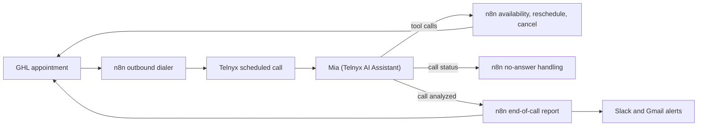

# Windy City Plumbing: Appointment Reminder Voice Agent

An outbound AI voice agent that calls plumbing customers before their appointment to confirm it, reschedule it or cancel it. Built on Telnyx AI Assistants, n8n and GoHighLevel.

## What it does

- GoHighLevel (GHL) triggers a reminder call 24 hours before an appointment. If that call is missed, a second call goes out 12 hours before.
- "Mia", the outbound assistant, confirms the customer will be home and collects any access notes.
- If the time no longer works, Mia checks the calendar and reschedules on the call. She can also cancel the appointment.
- A second assistant handles customers who call back, and can check availability and reschedule.
- After every call, n8n writes the outcome to GHL, adds a note and alerts the team on Slack and Gmail when a person needs to follow up.

## How it works



## What's in this repo

```
assistants/   Telnyx assistant configs (outbound reminder and inbound callback)
prompts/      Full system prompts for both assistants
n8n/          The n8n workflow (208 nodes, one canvas)
docs/         Outcome routing reference and the caller-facing security worksheet
```

## Stack

| Layer | Tool |
|---|---|
| Phone, speech and AI | Telnyx AI Assistants (model `moonshotai/Kimi-K2.6`, speech-to-text `deepgram/flux`) |
| Orchestration | n8n |
| CRM and calendar | GoHighLevel |
| Recovery state | Redis |
| Alerts | Slack, Gmail |

## Agent tools

| Tool | Outbound | Inbound | Purpose |
|---|---|---|---|
| `check_availability_windycity` | yes | yes | Reads open calendar slots |
| `reschedule_windycity` | yes | yes | Moves the appointment |
| `cancel_appointment_windycity` | yes | no | Cancels the appointment |
| `date_and_time_new_york_windycity` | yes | yes | Gives the agent the current time |
| `hangup` | yes | yes | Ends the call |

## Call outcomes

`confirmed`, `rescheduled`, `rescheduled_unconfirmed`, `cancelled`, `busy`, `wrong_person`, `no_meaningful_conversation`, `do_not_call`. Each has its own GHL update, note and alert rule. The full mapping is in `docs/call-outcome-routing.md`.

## Key design decisions

- **Two reminder calls.** One at 24 hours and one at 12 hours before the appointment. A customer who misses both is flagged for a person to follow up.
- **Live time from a tool.** The agent asks for the current time through a tool instead of trusting a time baked into the prompt, so "tomorrow" and "this Thursday" resolve correctly.
- **A "rescheduled but not confirmed" outcome.** If a new time was discussed but never locked in, the call is routed to a person instead of being recorded as rescheduled.
- **Guard against misheard cancellations.** A check flags a cancellation that may come from a misheard answer, so a real appointment is not lost to a transcription error.
- **Every tool call is validated in n8n.** Reschedule and cancel parameters are checked before they reach the calendar, whatever the model sends.
- **Recovery when a webhook goes missing.** Handled conversations are marked in Redis. A timed check pulls the conversation from the Telnyx API if the analysis webhook never arrives, and another check re-fires the first call if it never ran.
- **Voicemail is handled at the call router.** Answering-machine detection is read where the call is routed, so a voicemail never counts as a conversation.

## Caller-facing security

Prompt hardening in both prompts, a post-call transcript scan for manipulation attempts with Slack and email alerts, and n8n validation of every tool call. The worksheet behind these layers is in `docs/caller-facing-hardening-worksheet.md`.

## Placeholders

| Placeholder | Replace with |
|---|---|
| `your-n8n-instance.example.com` | Your n8n base URL |
| `YOUR_WEBHOOK_PATH` | The webhook paths you choose |
| `YOUR_GHL_LOCATION_ID` | Your GHL location ID |
| `YOUR_GHL_CALENDAR_ID` | Your GHL calendar ID |
| `YOUR_GHL_USER_ID_2`, `YOUR_GHL_USER_ID_4` | Your GHL staff user IDs |
| `YOUR_GHL_FIELD_ID_CALL_IN_PROGRESS`, `YOUR_GHL_FIELD_ID_EMERGENCY`, `YOUR_GHL_FIELD_ID_NEEDS_HUMAN_FOLLOWUP`, `YOUR_GHL_FIELD_ID_REMINDER_STATUS`, `YOUR_GHL_FIELD_ID_REMIND_ATTEMPT`, `YOUR_GHL_FIELD_ID_SERVICE_TYPE` | Your GHL custom field IDs (the name says which field) |
| `YOUR_TELNYX_PHONE_NUMBER` | Your Telnyx phone number |
| `YOUR_TELNYX_OUTBOUND_ASSISTANT_ID` | Your Telnyx outbound assistant ID |
| `YOUR_TELNYX_INBOUND_ASSISTANT_ID` | Your Telnyx inbound assistant ID |
| `YOUR_TELNYX_ACCOUNT_SID` | Your Telnyx account SID (in the TeXML URLs) |
| `YOUR_TELNYX_INSIGHT_ID` | Your Telnyx call-analysis insight ID |
| `YOUR_TEXML_APP_ID` | Your TeXML application ID |
| `YOUR_SLACK_USER_ID` | The Slack user who gets the alerts |

## License

All rights reserved. Published for viewing only. See [LICENSE](LICENSE).
